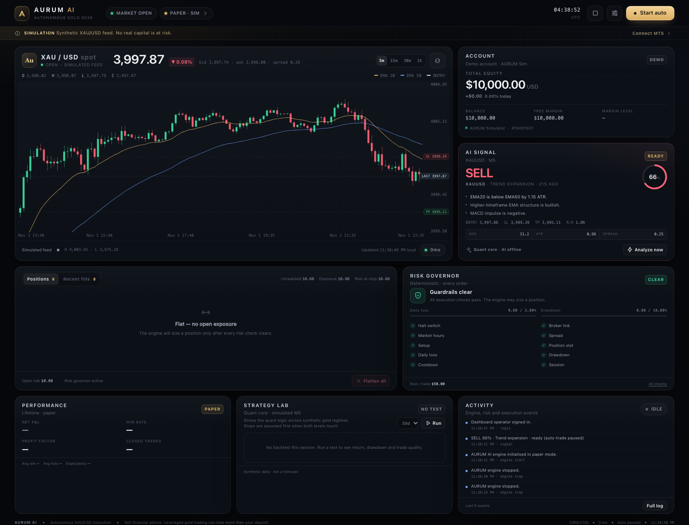

# AURUM AI

**An autonomous XAU/USD trading desk in one view.**  
Paper execution by default · deterministic risk governor · optional AI analyst · explicit MT4/MT5 terminal bridges.



> **Read this first — risk warning**  
> AURUM AI is experimental trading software, not financial advice and not a promise of profit.
> Leveraged gold trading can lose money quickly. The default mode is a **simulator**. Backtests
> may use synthetic or imported MT5 data; execution and costs are still simulated and are research
> output, not evidence of future returns. Trade a demo account first, use money you can afford to
> lose, and keep position sizes small.

---

## What is included

- **One-screen dashboard** — price chart, account, current signal, risk checks, positions,
  performance, backtest controls and audit activity. No page navigation required.
- **Hybrid signal engine** — a deterministic EMA/RSI/MACD/ATR/ADX model produces the trade
  thesis. An optional OpenAI-compatible analyst can temper or veto that thesis. The LLM cannot
  originate a trade, choose a lot size, or override risk.
- **Hard risk governor** — per-trade risk, daily loss limit, equity drawdown limit, position cap,
  spread cap, session window, market-hours check, cooldown and a persistent kill switch.
- **Automatic bracket management** — trails the stop toward profit and can extend the target when
  a trade is near target, already risk-free, and trend momentum still agrees. Works on paper and
  live MT5 positions.
- **Paper broker + realistic simulated XAU/USD feed** — market fills with spread, slippage and
  commission. The book persists in SQLite across restarts.
- **MetaTrader paths** — MT5 uses a small, token-authenticated Windows bridge; MT4 uses a polling
  Expert Advisor. Both connect view-only by default, with separate controls before execution.
- **Backtester** — event-driven, next-bar fills, conservative stop-first handling, configurable
  fees and spread. Runs on synthetic data or **imported MT5 history** for real Exness validation.
- **Security basics** — server-side password sessions, HttpOnly/SameSite cookies, login rate
  limiting, CSRF header checks, CSP and a non-root, read-only Docker container.
- **No Python runtime dependencies** — the dashboard and bridge client use the standard library.
  The MT5 bridge itself installs the official Windows-only `MetaTrader5` package.

## Quick start

### Local (easiest first run)

Requirements: Python **3.9+**. No pip install needed for the dashboard. On Windows, use Git Bash/WSL
for `setup.sh` or create `.env` from `.env.example` manually.

```bash
cd gold-ai-trader
./setup.sh          # creates .env with a random password and session secret
./run.sh            # http://localhost:8080
```

`setup.sh` prints the generated operator password. It also generates an MT4 EA token; both are stored
in `.env` (mode `600`). Copy `AURUM_EA_TOKEN` from that file into the MT4 EA's `InpToken` input.
Sign in, leave **Start auto** off, explore the simulated signal and run a backtest. When you are
comfortable, start paper automation and watch the risk governor respond.

If port 8080 is busy, set `AURUM_PORT` in `.env` before starting.

### Docker

```bash
cd gold-ai-trader
./setup.sh
docker compose up --build -d
docker compose logs -f
```

Open `http://localhost:8080`. The container runs as UID `10001`, has a read-only root filesystem,
drops Linux capabilities, and persists its database in the named volume `aurum-data`. The
`AURUM_HOST=0.0.0.0` / unauthenticated combination is refused by the app.

Useful commands:

```bash
docker compose ps
docker compose logs --tail=100
docker compose restart
docker compose down              # keeps the aurum-data volume
docker compose down -v           # DESTRUCTIVE: deletes the paper book and history
```

> Docker is optional. **For a live MT5 connection, running the dashboard natively on the same
> Windows machine as MetaTrader 5 is the simplest and safest topology.** Docker + MT5 needs a
> tunnel between the container and the Windows bridge; see below.

## The one-screen interface

| Area | What it does |
| --- | --- |
| **Headline chart** | XAU/USD candles, EMA 20/50, current price, and entry / SL / TP guides. Timeframes: 5m, 15m, 30m, 1h. |
| **Account** | Equity, balance, daily P&L, free margin and margin level from the active broker. |
| **AI signal** | Current action and confidence, regime, reasons, bracket levels, R:R and indicator snapshot. “Analyze now” never places an order. |
| **Positions** | Open exposure, P&L, stop/target and per-position close. The second tab shows recent fills. |
| **Risk governor** | Live pass/fail checks, daily-loss and drawdown meters, risk-per-trade budget, kill-switch state and all-check details. |
| **Dynamic SL/TP** | The positions footer reports whether auto protection is active; adjusted levels update in the position rows and audit log. |
| **Performance** | Lifetime closed-trade stats for the current mode. |
| **Strategy lab** | Run a 7/30/60-day simulated backtest or import MT5 CSV history and open the full equity report. |
| **Activity** | Audit trail of scans, signals, orders, risk blocks and connection changes. |
| **Settings drawer** | Strategy/risk/AI settings (validated server-side), paper reset, connection access and sign-out. |

### Controls and safety semantics

- **Start auto** arms the background scan loop. It is **off by default** and does **not** survive a
  server restart.
- **Pause auto** stops new entries. Existing positions keep their broker-side or simulated
  stop-loss / take-profit brackets.
- **Halt** sets a persistent kill switch. It blocks new entries but **does not close positions**.
  Clear it explicitly in the risk card.
- **Flatten all** closes every open position on the symbol at market — including positions you may
  have opened manually in MT5 — and requires typed confirmation.
- In live mode, **switch to paper is refused while live positions remain open**.
- A live session arm expires after **12 hours**. A restart also returns to paper mode.

## Connect MetaTrader 5

### Why a bridge?

MetaTrader 5 and its Python package are Windows-only. A Linux/Docker container cannot load MT5
directly. AURUM therefore separates the system into:

```text
 Browser ── session cookie ──> AURUM dashboard (Linux/Mac/Windows/Docker)
                                     │
                                     ├── paper broker + synthetic feed
                                     │
                                     └── bearer-token HTTP ──> Windows MT5 bridge ──> MT5 terminal
```

The bridge is `bridge/mt5_bridge.py`. It is the **only** component that sees your MT5 password.
The dashboard only sees account/position/market data and sends order instructions over the
token-authenticated bridge. The bridge token never reaches the browser.

### Step by step

1. **On Windows**, install and open MetaTrader 5. Log in to a **demo account** first and add
   `XAUUSD` (or your broker's exact gold symbol, e.g. `GOLD`) to Market Watch.
2. Install the bridge dependency:
   ```bat
   cd bridge
   py -3 -m venv .venv
   .\.venv\Scripts\activate
   pip install -r requirements.txt
   copy bridge.env.example bridge.env
   ```
3. Edit `bridge/bridge.env`:
   - `BRIDGE_TOKEN` — long random token.
   - `MT5_LOGIN`, `MT5_PASSWORD`, `MT5_SERVER` — the demo account.
   - `MT5_SYMBOL=XAUUSD` (must exactly match the symbol in Market Watch).
   - Keep `BRIDGE_ALLOW_LIVE=false` for now.
4. Start it:
   ```bat
   python mt5_bridge.py
   ```
   It binds to `127.0.0.1:8765` by default. Test it locally:
   ```bat
   curl -H "Authorization: Bearer YOUR_BRIDGE_TOKEN" http://127.0.0.1:8765/health
   ```
5. In the **dashboard** `.env` set the URL and the same token:
   ```dotenv
   AURUM_BRIDGE_URL=http://127.0.0.1:8765
   AURUM_BRIDGE_TOKEN=YOUR_BRIDGE_TOKEN
   ```
   Restart the dashboard.
6. Open **Connection & live access** in the dashboard and click **Connect MT5**. This is
   **view-only**: account, quotes and positions are visible, but execution is disabled.
7. To enable even demo execution, set `AURUM_LIVE_ENABLED=true` in the dashboard `.env`, restart,
   connect MT5, and **arm** the session with your `AURUM_LIVE_ARM_PHRASE` (default
   `ARM LIVE TRADING`). Arming is also required on demo; the bridge still refuses real orders while
   `BRIDGE_ALLOW_LIVE=false`.
8. Only after successful demo testing:
   - Set `BRIDGE_ALLOW_LIVE=true` on the bridge if you want real-account orders.
   - Point the bridge at a **live account**.
   - Arm and start small. The dashboard's live gate and the bridge's live gate are independent.

### Docker + MT5

Inside a container, `127.0.0.1` means the container itself. If the dashboard runs in Docker and the
bridge runs on the Windows host/VPS, do **not** expose the bridge port to the internet. Recommended
options:

- **Run the dashboard natively on the Windows MT5 machine** for live trading (simplest).
- Open an SSH tunnel from the Docker host to the Windows machine and point the container at the
  tunnel. The compose file already adds `host.docker.internal` on Linux:
  ```dotenv
  AURUM_BRIDGE_URL=http://host.docker.internal:8765
  ```
  The tunnel must listen on an address the container can reach; on Docker Desktop
  `host.docker.internal` reaches the host, while on Linux you generally bind the tunnel to a
  firewall-restricted host interface. A private VPN (Tailscale/WireGuard) is also fine.
- Never change the bridge to bind `0.0.0.0` on a public network. The bridge speaks plain HTTP and
  relies on the network boundary plus its bearer token.

The bridge rejects a symbol mismatch at connect time, so `AURUM_SYMBOL` and `MT5_SYMBOL` must match.

Full bridge details: [`bridge/README.md`](bridge/README.md).

## Connect MetaTrader 4 (EA)

The MT4 Expert Advisor polls the dashboard and receives queued commands; the dashboard does not
connect to MT4 directly. For the simplest setup, run both on the same Windows computer. The EA
starts view-only, and the dashboard's existing arm gate is still required before it can execute.

1. Set a long random `AURUM_EA_TOKEN` in the dashboard `.env`. `./setup.sh` generates one for new
   installs; use the same value in the EA's `InpToken` input. Keep it out of source control and do
   not paste it into the browser.
2. Keep `AURUM_LIVE_ENABLED=false` while testing. Set `AURUM_SYMBOL` to the exact MT4 chart symbol,
   including any broker suffix.
3. Copy [`mt4/AURUM_EA.mq4`](mt4/AURUM_EA.mq4) into the terminal's `MQL4/Experts` folder and
   compile it in MetaEditor. Attach it to the matching symbol, leave `InpAllowLive=false`, and enable
   MT4 AutoTrading.
4. In **Tools → Options → Expert Advisors**, enable **Allow WebRequest for listed URL** and add
   `http://127.0.0.1`. The default EA endpoint is `http://127.0.0.1/api/ea/poll`.
   [MetaQuotes documents](https://docs.mql4.com/common/webrequest) that MQL4 selects port 80 for
   HTTP; it does not use the dashboard's default port 8080. Docker Compose already maps the
   dashboard to loopback port 80. For a native dashboard, set `AURUM_PORT=80` before starting it.
5. In the dashboard's **Connection & live access** panel, choose **Connect MT4**. Check that the EA
   heartbeat appears and confirm the account, symbol and quotes before arming. To trade a demo
   account, enable `AURUM_LIVE_ENABLED=true`, restart, then arm with the configured phrase. The EA
   separately blocks real-account orders while `InpAllowLive=false`.

Keep the HTTP endpoint on loopback. If MT4 and the dashboard must run on separate computers, use a
private VPN and a firewall-restricted route; do not expose this token-authenticated HTTP endpoint to
the public internet.

## The signal engine

The deterministic core uses **closed candles only**:

- EMA 20 / 50 / 200 for structure and higher-timeframe bias;
- RSI(14) for momentum and exhaustion;
- MACD(12,26,9) histogram for impulse;
- ATR(14) for volatility-aware stops and targets;
- ADX(14) and DI spread for regime detection;
- 20-bar breakout plus candle body and EMA slope.

The components are blended into a signed conviction score. Confidence gates entries, and the
bracket is `entry ± ATR × atr_stop_mult` with a target at `rr_ratio × risk`. A smaller
range-fade sleeve only activates in genuinely ranging/compressed conditions.

### Optional AI analyst

Set an OpenAI-compatible endpoint:

```dotenv
AURUM_AI_API_KEY=sk-...
AURUM_AI_BASE_URL=https://api.openai.com/v1
AURUM_AI_MODEL=gpt-4o-mini
```

A local Ollama-compatible endpoint works too:

```dotenv
AURUM_AI_API_KEY=ollama
AURUM_AI_BASE_URL=http://host.docker.internal:11434/v1
AURUM_AI_MODEL=llama3.1
```

What the overlay can and cannot do:

- It receives a compact numeric market/feature summary and returns strict JSON
  (`bias`, `confidence`, `rationale`, `risks`).
- Validation and clamping happen server-side. Its maximum blend weight is **30%**.
- It can veto or reduce a quant setup into a WAIT. It **cannot originate** a trade, change lot
  size, alter stops, or bypass the risk governor.
- If the analyst is absent, disabled, slow or returns garbage, the deterministic model continues.
- If the key is blank the overlay is inactive and the signal card shows **AI offline**. There is an
  `ai_overlay` setting in Settings. Calls may be cached for 45 seconds.
- Sending data to a third-party model has privacy/cost implications. Do not configure one if you
  do not want numeric market features leaving your machine.

The optional model is a **review layer**, not a profit oracle. No LLM is used in backtests.

## Risk model

Every market order must pass every check in `app/risk.py`:

| Guard | Default |
| --- | --- |
| Risk per trade | 0.5% of equity |
| Daily loss limit | 3% (UTC day) |
| Peak-to-equity drawdown | 10% |
| Max open positions | 1 |
| Max lots | 1.00 |
| Max spread | $0.45 |
| Trade cooldown | 15 minutes after close |
| Session | 00:00–24:00 UTC (configurable) |
| Market hours | Closed weekends / Friday late |
| Confidence floor | 64% |
| Reward/risk | 1.8R target |
| Dynamic brackets | Trailing stop after 1.0R; extension budget 2 |

Sizing is stop-distance based, rounded **down** to the broker lot step, capped by `max_lots`, checked
against free margin, and rejected if even the minimum lot exceeds the risk budget. The server, not
the browser, enforces validation.

The risk governor is deliberately independent of the AI. A language model cannot change a limit,
size an order, or place one.

## Automatic SL / TP management

Once a position is open, the engine evaluates its bracket every few seconds while managing the
book:

1. **Trail the stop** after the trade earns `breakeven_at_r` (default **1.0R**). The stop follows
   current price at `trailing_atr_mult` × ATR (default **1.2 × ATR**), is floored at break-even on
   a long / capped at break-even on a short, and can **never move backwards**.
2. **Extend the take-profit** when price is within 0.30 ATR of the original/current target, the
   stop is already at or beyond break-even, momentum (the latest quant score) still favors the
   trade, and the per-position extension budget remains. Each extension moves the target
   `tp_extension_atr` ATR further away, up to `max_tp_extensions` times (default **2**).
3. **Write the change** through the paper book or MT5 `/modify` endpoint. Live changes require the
   session to be armed. The broker's minimum stop distance is enforced.

These are defaults and can be changed under **Settings → Trade management**:

| Setting | Default | Meaning |
| --- | --- | --- |
| Dynamic SL / TP | on | Master switch for automatic bracket management. |
| Break-even trigger | 1.0R | Profit required before the trail begins. |
| Trailing distance | 1.2 × ATR | Distance kept between price and the trailing stop. |
| Extend winners | on | Allow target extensions when momentum agrees. |
| Target extension | 0.8 × ATR | Distance added to the target per extension. |
| Max target extensions | 2 | Hard cap per position; 0 disables extension. |

The manager only operates on positions opened/tracked by AURUM; it will not silently rewrite a
manually opened MT5 position. If a live bracket update is rejected (for example by the broker's
minimum-stop rule), the engine logs it and retries later; it does not pause trading or hide the
existing protection. Disable the master switch to keep entry brackets static.

## Backtesting

The **Strategy lab** has two data paths:

1. **Synthetic** — 7, 30 or 60 days of generated M5 gold data, useful for exercising the engine.
2. **Imported MT5 history** — export real XAU/USD bars from MetaTrader 5 and upload them as CSV.

Both paths:

- evaluate only closed candles and fill at the next bar open;
- apply the configured spread, slippage and round-turn commission;
- model the dynamic stop trail / target extension at bar close;
- assume **stop first** when a bar touches both stop and target;
- respect the session, daily-loss, drawdown and cooldown settings;
- return equity, drawdown, win rate, profit factor, Sharpe (only with enough daily observations),
  buy-and-hold comparison and sample trades.

### Importing real Exness MT5 data

1. In MetaTrader 5 (the Exness terminal), open an **XAUUSD M5** chart and scroll back to load enough
   history — at least 30 days is useful.
2. Open **History Center** (`F2`), select XAUUSD / M5, and use **Export**. Alternatively save the
   chart data via the terminal's file/export menu as CSV. Any CSV with date, time, open, high, low
   and close columns works; comma, tab and semicolon separators are detected.
3. In **Strategy Lab**, click **CSV**.
4. Enter:
   - **Server UTC offset** — Exness server time is usually **GMT+2 in winter / GMT+3 in summer**.
     The importer converts timestamps to UTC.
   - **Spread** — use your typical XAUUSD Raw Spread, e.g. `0.20` dollars per ounce.
   - **Commission** — your round-turn commission per lot. Raw Spread gold is commonly around
     `$7` per lot round turn; use the exact number from Exness.
5. Run the test. The card changes to **MT5 CSV** and the report shows the imported bar count,
   timeframe and cost assumptions.

The backtester cannot verify the provenance of a CSV. It does not model tick-level spread widening,
swap, broker rejections, news slippage or liquidity. Execution is still simulated; a green result is
not a promise of live performance. Validate out-of-sample before risking real money.

The synthetic path remains useful for regression testing, but it is not evidence that the strategy
will work on Exness. Do not tune parameters until one synthetic sample looks profitable; use the
imported data and reserve a separate validation period.

## Configuration reference

Dashboard variables (`.env`):

| Variable | Default | Purpose |
| --- | --- | --- |
| `AURUM_HOST` | `127.0.0.1` | Bind address. `0.0.0.0` requires authentication. |
| `AURUM_PORT` | `8080` | Dashboard port. Compose maps this to container port 8080. |
| `AURUM_DATA_DIR` | `./data` | SQLite data directory. Compose overrides to `/data`. |
| `AURUM_DASHBOARD_PASSWORD` | generated | Operator password. Empty is allowed only on loopback. |
| `AURUM_SECRET_KEY` | generated | HMAC signing key for sessions. Keep stable. |
| `AURUM_COOKIE_SECURE` | `false` | Set `true` behind HTTPS. |
| `AURUM_SYMBOL` | `XAUUSD` | Dashboard's instrument; must match the bridge symbol. |
| `AURUM_PAPER_BALANCE` | `10000` | Initial simulated balance. |
| `AURUM_LIVE_ENABLED` | `false` | Enables MT4/MT5 arming. Does not itself place orders. |
| `AURUM_LIVE_ARM_PHRASE` | `ARM LIVE TRADING` | Phrase required to arm. Change it. |
| `AURUM_BRIDGE_URL` | `http://127.0.0.1:8765` | Windows bridge base URL. |
| `AURUM_BRIDGE_TOKEN` | — | Bearer token, must match the bridge. Empty disables MT5. |
| `AURUM_EA_TOKEN` | — | Shared secret for the MT4 EA polling endpoint. Empty disables MT4. |
| `AURUM_AI_API_KEY` | — | OpenAI-compatible key. Empty = quant-only. |
| `AURUM_AI_BASE_URL` | `https://api.openai.com/v1` | API base, no trailing `/chat/completions`. |
| `AURUM_AI_MODEL` | `gpt-4o-mini` | Model name. |
| `AURUM_LOG_LEVEL` | `INFO` | Server log level. |

Bridge variables: see [`bridge/bridge.env.example`](bridge/bridge.env.example).

## HTTP API

The dashboard is also a small JSON API. When authentication is enabled, all `/api/*` routes except
`/api/auth` and `/api/login` need the session cookie. State-changing requests also require the
`X-AURUM-CSRF: 1` header. The bundled UI handles this.

```text
GET  /healthz                     public liveness probe
GET  /api/auth                    session status
POST /api/login                   {"password": "..."}
POST /api/logout
GET  /api/bootstrap               settings schema + environment capability flags
GET  /api/state                   full dashboard snapshot
GET  /api/candles?timeframe=M5&limit=200
GET  /api/trades?limit=100
GET  /api/logs?limit=200
POST /api/analyze                 fresh signal, never an order
POST /api/bot/start | /api/bot/pause
POST /api/halt | /api/halt/clear
POST /api/positions/close         {"ticket": "..."}
POST /api/positions/close-all
POST /api/mode                    {"mode": "paper" | "mt4" | "mt5"}
POST /api/reconnect
POST /api/live/arm                {"phrase": "..."}
POST /api/live/disarm
POST /api/settings                {"settings": {...}}
POST /api/reset-paper             {"confirm": "RESET PAPER"}
POST /api/backtest                {"days": 30}
GET  /api/backtest/latest
POST /api/backtest/csv             {"filename": "...", "csv": "...", "utc_offset_minutes": 120, "spread": 0.20, "commission_per_lot": 7.0}
```

There is intentionally no generic order endpoint. Execution only happens through the engine,
with the risk governor in the path.

## Architecture and security

- [`ARCHITECTURE.md`](ARCHITECTURE.md) — components, execution flow, persistence and failure modes.
- [`SECURITY.md`](SECURITY.md) — threat model, deployment checklist and live-trading controls.
- [`bridge/README.md`](bridge/README.md) — MT5 bridge protocol, configuration and troubleshooting.

## Tests

```bash
make test
# or
PYTHONPYCACHEPREFIX=/tmp/aurum-pyc PYTHONDONTWRITEBYTECODE=1 \
  python3 -m unittest discover -s tests -v
```

The suite covers indicators, no-look-ahead EMA behaviour, strategy direction and AI vetoes, every
risk gate, paper round trips, SQLite settings/reset, signed cookies, login rate limiting,
backtest structure, MT4 poll/command/result round trips, MT5 bridge safety/idempotency, and a full
mock-bridge live flow (connect → arm → order → close → mode safety).

## Project layout

```text
gold-ai-trader/
├── app/
│   ├── main.py           entrypoint + graceful shutdown
│   ├── api.py            standard-library HTTP server, auth and static hosting
│   ├── engine.py         autonomous loop, mode/live gating, reconciliation
│   ├── strategy.py       quant signal model + capped AI overlay
│   ├── ai.py             optional OpenAI-compatible analyst
│   ├── risk.py           deterministic order governor
│   ├── broker.py         paper broker + MT5 bridge client
│   ├── ea.py             MT4 polling EA adapter
│   ├── market.py         simulated XAU/USD feed
│   ├── backtest.py       event-driven synthetic backtester
│   ├── db.py             SQLite schema and persistence
│   ├── settings.py       typed, validated settings schema
│   └── static/           dependency-free dashboard
├── bridge/               Windows MetaTrader 5 bridge
├── mt4/                  MetaTrader 4 Expert Advisor
├── tests/                unittest suite
├── Dockerfile
├── docker-compose.yml
├── setup.sh
└── run.sh
```

## Known limitations

- MT5 requires Windows and a running terminal; the bridge is not a Linux MT5 emulator.
- One symbol and one operator. No multi-account routing.
- Market orders only. Dynamic brackets are supported, but there are no partial closes, pending
  orders, news calendar or economic event filters yet.
- The backtester can import real MT5 history, but it does not model tick-level spreads, swap,
  broker rejections or actual execution quality.
- Live reconciliation relies on bridge position/history data. If the bridge is down, protect the
  account directly in MT5.
- The LLM overlay is optional and fallible; it is not a guarantee or a fiduciary advisor.

## Disclaimer

AURUM AI is provided as experimentation and engineering tooling, **as-is and without warranty**.
Nothing in this repository is investment advice, a solicitation, or a guarantee of performance.
You are solely responsible for broker terms, taxes, regulatory compliance, account security and
every order placed. Test on a demo account. Never risk funds you cannot afford to lose.
